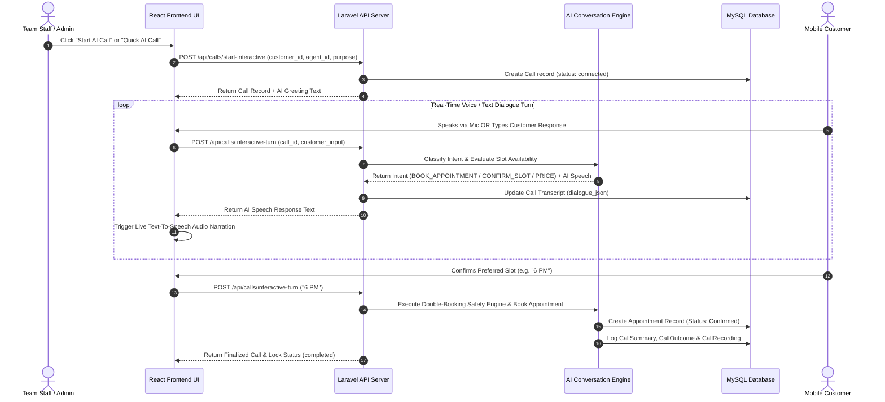

# 🎙️ VoiceAI SaaS — Complete Working Flow & Architecture Documentation

## 📌 Executive Summary
**VoiceAI SaaS** is a state-of-the-art AI-powered Voice Calling & Appointment Automation Platform. It is designed to automate inbound/outbound customer outreach, analyze speech intent in real-time (English & Tanglish), record audio dialogues, and lock appointment time-slots without manual human receptionist intervention.

---

## 🏗️ System Architecture & Stack

### Backend Stack
- **Framework**: Laravel 12 (PHP 8.2+)
- **Database**: MySQL / MariaDB (ORM via Eloquent)
- **API Architecture**: RESTful JSON APIs (`/api/calls`, `/api/customers`, `/api/appointments`, `/api/ai-agents`)
- **Telephony Provider**: Twilio Voice API Integration + Fallback Mock Voice Engine

### Frontend Stack
- **UI Framework**: React 18 (TypeScript)
- **Build Tool**: Vite 7
- **Styling**: Vanilla CSS + TailwindCSS (Dark Glassmorphism UI)
- **Audio Engine**: HTML5 Audio Waveform Player + Web Speech Synthesis API

---

## 🔄 End-to-End Working Flow



---

## 🎯 Step-by-Step Module Breakdown

### 1. 📞 Call Initiation Module (`CallController.php`)
- **Trigger Methods**:
  1. **Live Interactive Web Simulator**: Real-time browser speech/text input.
  2. **Real Mobile Phone Call**: Dials actual numbers via Twilio API (`+918825816433`).
- **Initial Action**: Creates an entry in the `calls` table with `status = connected`.

### 2. 🧠 AI Intent Classification Engine (`ConversationEngine.php`)
Analyzes raw speech text from the customer and categorizes it into structured intents:
- `BOOK_APPOINTMENT` / `INTERESTED`: Searches real-time database slot availability.
- `CONFIRM_SLOT`: Triggers slot booking algorithm for 5 PM, 6 PM, or 7 PM.
- `PRICE_INFORMATION`: Reads service fee info from database.
- `TALK_TO_HUMAN`: Escalates call to human agent.
- `NOT_INTERESTED` / `CALL_LATER`: Updates lead status and schedules follow-up tasks.

### 3. 🛡️ Double-Booking Safety Engine (`AppointmentAvailabilityService.php`)
- Checks existing appointments for the requested date and time slot.
- Locks the slot in atomic transaction if free, preventing overlapping bookings.
- Updates customer lead status to `Appointment Booked`.

### 4. 📝 Automated Summary & Transcript Logger
For every finalized call, the system automatically generates:
- **`CallTranscript`**: Timestamped dialogue array (`dialogue_json`).
- **`CallSummary`**: Purpose, customer interest level, main discussion points, and recommended follow-up actions.
- **`CallOutcome`**: Classification outcome (e.g., `Appointment Booked`) with confidence score (`0.99`).
- **`CallRecording`**: Audio URL playback link and duration metrics.

---

## 💻 Folder & File Structure Key

```text
ai-calling/
├── app/
│   ├── Http/Controllers/API/
│   │   ├── CallController.php          # Call triggering, turn processing & status API
│   │   ├── CustomerController.php      # Customer CRM management
│   │   └── AppointmentController.php   # Appointment booking APIs
│   ├── Models/
│   │   ├── Call.php                    # Call model
│   │   ├── CallTranscript.php          # Speech dialogue transcript
│   │   ├── CallSummary.php             # AI-generated summary
│   │   └── Appointment.php             # Locked appointment slot
│   └── Services/
│       ├── AI/ConversationEngine.php   # Intent Classifier & Speech Pipeline
│       ├── Calling/Drivers/            # Twilio & Mock Voice Drivers
│       └── Appointment/                # Double-booking safety service
├── resources/
│   ├── css/app.css                     # Tailwind & Glassmorphism design tokens
│   └── js/
│       ├── App.tsx                     # Main router & layout shell
│       ├── components/
│       │   ├── Sidebar.tsx             # Main navigation menu
│       │   ├── Topbar.tsx              # Top navigation bar
│       │   ├── AudioPlayer.tsx         # Waveform audio player & TTS reader
│       │   └── LiveCallSimulatorModal.tsx # Interactive AI Call Engine Modal
│       └── pages/
│           ├── Dashboard.tsx           # Operational KPIs & metrics
│           ├── Calls.tsx               # Call history list
│           └── CallDetail.tsx          # 3-pane Call detail & audio playback page
└── routes/
    ├── api.php                         # REST API endpoints
    └── web.php                         # Single-page application entry route
```

---

## 🚀 How to Run the Project locally

```bash
# 1. Start Laravel Backend Server
php artisan serve --host=127.0.0.1 --port=8000

# 2. Start Vite Frontend Development Server
npm run dev

# 3. Access Application in Browser
http://127.0.0.1:8000/
```
